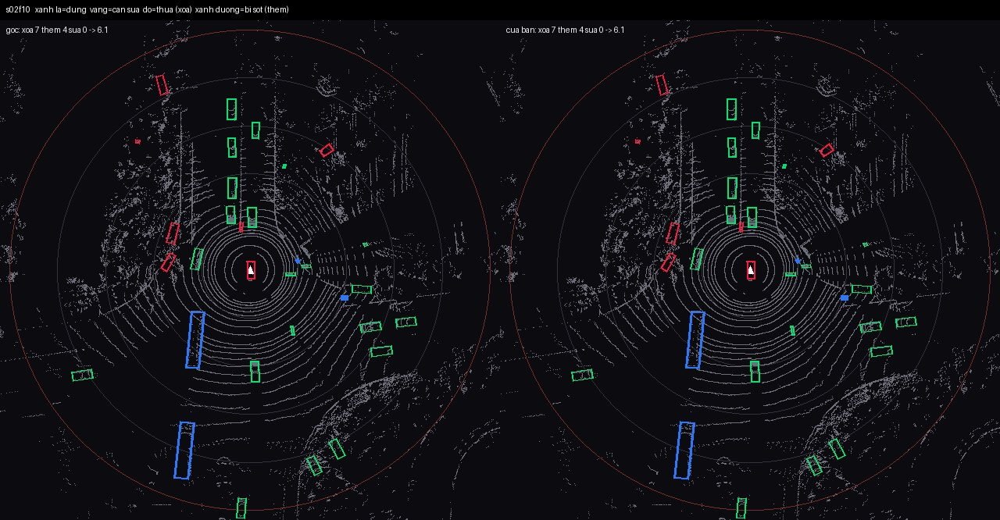

# Báo cáo Day 14 — Lê Quang Vinh — 04059

> Sao chép file này thành `report/individual/<MSSV>_<HoTen>.md` (không dấu), ví dụ `2A20260000_NguyenVanAn.md`.

- Mã học viên dùng với `--student`: `04059`
- `seed_tag` trong `frames_A.txt`: `D14-CEA1144A4E81`

## 1. Dự đoán trước sweep (bước 5b)

Ghi **trước** khi chạy `scripts/pp_sweep.py`, rồi commit và push ngay (lịch sử commit là bằng chứng thời điểm viết). Không sửa phần này sau khi có kết quả.

- Tham số tôi nghĩ giảm công sửa nhiều nhất: `score_thr` (tăng từ `0.1` lên khoảng `0.3`–`0.4`) và `min_points` (tăng từ `0` lên khoảng `5`–`10`).
- Vì sao (nhìn ảnh BEV tập A: box thừa nhiều hay box sót nhiều?): Trên ảnh BEV của 3 frame tập A (`s01f26`, `s02f10`, `s04f35`), mô hình gốc (`score_thr=0.1`, `min_points=0`) sinh nhiều box có độ tin cậy thấp hoặc ít điểm LiDAR ở xa/ven đường, đồng thời cũng còn vật thể thật bị sót hoặc lệch nhãn. Tăng `score_thr` và `min_points` kỳ vọng lọc bỏ box rác/nhiễu để giảm số box phải xóa, dù có thể làm tăng nhẹ box phải thêm.

## 2. Tập A: sửa tay và tune

| Cấu hình | Xóa | Thêm | Sửa | Chi phí |
|---|---:|---:|---:|---:|
| Gốc | 18 | 6 | 1 | 11.9 |
| `best_config.json` | 18 | 6 | 1 | 11.9 |

- Tham số đã đổi trong `best_config.json`: Không có (`score_thr=0.1`, `min_points=0` và các tham số còn lại giữ nguyên cấu hình gốc).
- Kết quả leave-one-out (dán các dòng `scripts/pp_sweep.py` in ra): *(dán nguyên văn phần leave-one-out in ra trên terminal ở bước 6 nếu có)*
- Cấu hình có ổn định trên từng frame không? Vì sao tôi vẫn chọn (hoặc không chọn) nó: Trên bảng quét `sweep.csv` của 3 frame tập A, cấu hình gốc (`score_thr=0.1`, `min_points=0`) có chi phí thấp nhất (`11.9`). Khi tăng `score_thr` lên `0.4`–`0.5` hoặc `min_points` lên `5`–`10`, số box xóa giảm (`18` xuống `2`) nhưng số box thêm tăng mạnh (`6` lên `23`), làm tổng chi phí tăng lên `12.6`–`23.6` do thêm box tốn `1.0` điểm còn xóa box chỉ tốn `0.3` điểm. Vì vậy giữ nguyên cấu hình gốc trong `best_config.json` là hợp lý theo tiêu chí chi phí trên tập A.

## 3. Trước/sau (bước 8)

- `scripts/pp_compare.py` báo giảm `0%` công sửa trên tập A (`chi phí gốc` `11.9` vs `của bạn` `11.9`: `s01f26` `0.9`, `s02f10` `6.1`, `s04f35` `4.9`).
- Dự đoán ở mục 1 đúng hay sai? Giải thích bằng số box xóa/thêm/sửa: Dự đoán ở Mục 1 chỉ đúng một phần ở chiều hướng lọc box thừa khi tăng ngưỡng (như trên `sweep.csv`, tăng `score_thr` và `min_points` giúp giảm số box xóa từ `18` xuống còn `7` ở ngưỡng `0.4` và `2` ở ngưỡng `0.5`), nhưng sai ở kỳ vọng tổng chi phí sẽ giảm. Thực tế số box thêm tăng từ `6` lên `18`–`23` khiến chi phí tăng cao hơn mức `11.9` của cấu hình gốc, nên `best_config.json` giữ cấu hình gốc và giảm `0%` chi phí.

## 4. Tập B

Số đo từ `scripts/pp_prelabel.py --frames d14_04059/frames_B.txt --config d14_04059/best_config.json --gt d14_04059/ref_B.json`:

| Xóa | Thêm | Sửa | Chi phí |
|---:|---:|---:|---:|
| 94 | 10 | 3 | 39.7 |

- Loại box tốn công sửa nhất ở tập B: Thao tác **xóa** (`94` box, chiếm `28.2 / 39.7` tương đương `71.0%` tổng chi phí sửa) là phần tốn công nhất vì mô hình dự đoán `355` box so với `271` box GT (`khớp 261`), tạo ra nhiều box dư thừa/dương tính giả ở ngưỡng `score_thr=0.1`, `min_points=0`; tiếp theo là **thêm** (`10` box, chiếm `10.0 / 39.7` tương đương `25.2%` chi phí) cho các vật thể bị sót, còn **sửa** chỉ có `3` box (`1.5 / 39.7` tương đương `3.8%` chi phí).

## 5. Giới hạn

- Tập tune chỉ có 3 frame (`s01f26`, `s02f10`, `s04f35`) so với 12 frame tập B, nên cấu hình tối ưu trên tập A có thể chưa đại diện đầy đủ cho mọi bối cảnh giao thông ở tập B.
- Mô hình PointPillars pre-trained trên KITTI (3 lớp chính `Car`, `Pedestrian`, `Cyclist`) chưa khớp hoàn toàn miền dữ liệu VF và không có sẵn lớp `Truck`/`Bus` nguyên bản, dễ phát sinh box dư hoặc bỏ sót vật thể.
- Công thức chi phí sửa (`0.3·xóa + 1.0·thêm + 0.5·sửa`) chỉ phản ánh số lượng thao tác theo ngưỡng đánh giá hình học, chưa đo trực tiếp thời gian thao tác thực tế của người gán nhãn trên CVAT.
